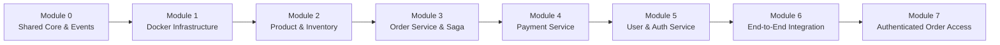

# 📘 Step-by-Step Module Implementation Guide

This guide walks you through building the **Event-Driven E-Commerce Microservices Platform** step-by-step, module-by-module. 

Instead of trying to build all services at once, follow this phased progression so you can verify each component before moving to the next.

---

## 🗺️ Implementation Roadmap Overview



---

## 🔹 Module 0: The Shared Library (`common/`)

> **Goal**: Define the event contracts and messaging helpers so every service speaks the exact same data protocol.

### Why do this first?
If services disagree on event schemas (e.g. one expects `order_id` and another sends `id`), the distributed system breaks silently.

### Files to Create:
```text
common/
├── pyproject.toml / setup.py
└── common/
    ├── __init__.py
    ├── events.py        # Pydantic models for all event payloads
    └── rabbitmq.py      # Async connection & publishing helpers (aio-pika)
```

### Key Tasks:
1. **Define Pydantic Event Models**:
   - `OrderCreatedEvent`: `order_id`, `user_id`, `items: list[OrderItem]`, `total_amount`, `timestamp`.
   - `InventoryReservedEvent`: `order_id`, `items`, `timestamp`.
   - `InventoryFailedEvent`: `order_id`, `reason`.
   - `PaymentSucceededEvent`: `payment_id`, `order_id`, `amount`, `timestamp`.
   - `PaymentFailedEvent`: `order_id`, `reason`.
2. **Write RabbitMQ Client Helper**:
   - Reusable async publisher using `aio-pika`.
   - Exchange declaration: Topic Exchange (`ecommerce_exchange`).

---

## 🔹 Module 1: Local Infrastructure Setup (`docker-compose.yml`)

> **Goal**: Get the databases and message broker running locally with persistent storage and management dashboards.

### Services to Boot:
- **RabbitMQ**: Port `5672` (AMQP) and `15672` (Management Web UI).
- **PostgreSQL**: Port `5432` (Create databases for User, Order, Payment).
- **MongoDB**: Port `27017` (Product Catalog database).

### Verification Checklist:
- [ ] Open RabbitMQ dashboard at `http://localhost:15672` (login: `guest` / `guest`).
- [ ] Connect to PostgreSQL with a DB client (e.g., TablePlus, DBeaver, or `psql`).
- [ ] Connect to MongoDB using MongoDB Compass or `mongosh`.

---

## 🔹 Module 2: Product & Inventory Service (MongoDB)

> **Goal**: Store dynamic product details and handle stock reservation logic.

### Tech Stack:
- **FastAPI** + **Motor** (or **Beanie** ODM) + **aio-pika**

### What to Build:
1. **Database Models**:
   - `Product`: `id`, `name`, `description`, `price`, `stock_quantity`, `reserved_quantity`.
2. **REST Endpoints**:
   - `GET /products` (list catalog)
   - `POST /products` (create new product with stock)
3. **Background Event Consumer**:
   - Listen to topic `order.created`.
   - Atomic reservation: Use MongoDB's `find_one_and_update` with filter `stock_quantity >= quantity` to safely prevent overselling.
   - If stock is sufficient: Emit `inventory.reserved`.
   - If stock is insufficient: Emit `inventory.insufficient`.
   - Listen to `payment.failed`: Compensating action — rollback/release reserved stock.

---

## 🔹 Module 3: Order Service (PostgreSQL)

> **Goal**: Manage order lifecycles and initiate the Saga workflow.

### Tech Stack:
- **FastAPI** + **SQLAlchemy (Async)** + **asyncpg** + **aio-pika**

### What to Build:
1. **Database Schema**:
   - `orders`: `id` (UUID), `user_id`, `total_price`, `status` (`PENDING`, `CONFIRMED`, `CANCELLED`), `created_at`.
   - `order_items`: `id`, `order_id`, `product_id`, `quantity`, `price`.
2. **REST Endpoints**:
   - `POST /orders`:
     - Validates payload.
     - Saves order to database with status `PENDING`.
     - Publishes `order.created` event to RabbitMQ.
     - Returns HTTP `202 Accepted` with order ID.
   - `GET /orders/{order_id}`: Inspect real-time status.
3. **Background Event Consumers**:
   - Listen to `payment.succeeded`: Update order status to `CONFIRMED`.
   - Listen to `payment.failed` / `inventory.insufficient`: Update order status to `CANCELLED`.

---

## 🔹 Module 4: Payment Service (PostgreSQL)

> **Goal**: Simulate payment authorization with idempotency guarantees.

### Tech Stack:
- **FastAPI** + **SQLAlchemy** + **aio-pika**

### What to Build:
1. **Idempotency Table**:
   - `idempotency_keys`: `key` (UUID/Order ID), `status`, `response_payload`, `created_at`.
   - Ensures an event delivered twice does not charge the customer twice.
2. **Payment Processing Consumer**:
   - Consumes `inventory.reserved`.
   - Checks idempotency record.
   - Simulates processing (e.g. 90% success, 10% simulated failure to test rollback).
   - If success: Record transaction, publish `payment.succeeded`.
   - If failure: Record failure, publish `payment.failed`.

---

## 🔹 Module 5: User & Authentication Service (PostgreSQL)

> **Goal**: Handle secure user signup, login, and JWT issuance.

### Tech Stack:
- **FastAPI** + **SQLAlchemy** + **Passlib (bcrypt)** + **PyJWT**

### What to Build:
1. **Database Schema**:
   - `users`: `id`, `email` (unique), `hashed_password`, `full_name`, `created_at`.
2. **REST Endpoints**:
   - `POST /users/register`: Hash password and create user.
   - `POST /users/login`: Verify credentials and return JWT bearer token.
   - `GET /users/me`: Return current authenticated user profile.
3. **Inter-Service Security**:
   - Orders will reference the `user_id` extracted from the verified JWT.

---

## 🔹 Module 6: End-to-End Testing & Verification

> **Goal**: Test the complete distributed transaction workflow.

### Test Case 1: The Happy Path
1. Create a user (`POST /users/register`).
2. Add a product with stock = 10 (`POST /products`).
3. Place an order for 2 items (`POST /orders`).
4. Watch RabbitMQ logs:
   - `order.created` emitted.
   - `inventory.reserved` emitted (stock drops to 8).
   - `payment.succeeded` emitted.
   - Order status automatically transitions from `PENDING` ➔ `CONFIRMED`.

### Test Case 2: The Insufficient Stock Path
1. Place an order for 100 items (when only 8 exist).
2. Product service emits `inventory.insufficient`.
3. Order service transitions from `PENDING` ➔ `CANCELLED`. No payment attempted.

### Test Case 3: The Payment Failure & Rollback Path (Compensating Transaction)
1. Place order with mock failing card / trigger simulated payment failure.
2. Payment service emits `payment.failed`.
3. Order service transitions to `CANCELLED`.
4. Product service receives `payment.failed` and adds reserved stock back to available stock.

### Verification Commands:
Run the comprehensive Saga integration test suite:
```bash
python3 -m unittest tests/test_e2e_saga.py
# Or run the verification runner:
python3 scripts/verify_e2e.py
```

---

## 🔹 Bonus Service: Notification Service (`services/notification_service/`)

> **Goal**: Consume domain events and dispatch customer communications (Email & SMS).

### Tech Stack:
- **FastAPI** + **aio-pika** (Port `8005`)

### What Was Built:
1. **Background Consumer**:
   - Listens to `order.created`, `order.confirmed`, `order.cancelled`, `payment.succeeded`, `payment.failed`, and `inventory.failed`.
   - Records real-time notification dispatches.
2. **REST Inspection Endpoints**:
   - `GET /notifications`: View dispatched notification history.
   - `GET /notifications/{order_id}`: View notifications for a specific order.
   - `DELETE /notifications`: Reset notification log.

---

## 🔹 Module 7: Authenticated Order Access

> **Goal**: Connect the User Service's JWT login to the Order Service and isolate each customer's orders.

### Implemented Behavior
- Every `/orders` endpoint requires `Authorization: Bearer <access_token>`.
- Tokens must have a valid signature, an expiration (`exp`), and a nonempty customer subject (`sub`).
- `POST /orders` derives customer identity from the token. The legacy body `user_id` is optional; a mismatched value returns 403.
- `GET /orders` always filters by the token subject. The legacy `user_id` query parameter is accepted only when it matches that subject; mismatches return 403.
- Reading or cancelling another customer's order returns 404, just like a nonexistent order.
- Existing order events, pagination, cancellation rules, and internal Saga repository access remain available.
- Docker Compose passes the same configured `JWT_SECRET_KEY` and `JWT_ALGORITHM` to User and Order services.

### Verification
```bash
# From the repository root, after installing the service requirements and common package:
python3 -m pip install -r requirements-dev.txt
python3 -m unittest tests.test_order_security tests.test_e2e_saga -v
PYTHONPATH=common python3 common/tests/test_events.py
```

The HTTP regression suite uses SQLite and signed JWTs, with a mocked broker. It covers missing, malformed, expired, incorrectly signed, and incomplete tokens; customer impersonation; list/read/cancel ownership; real User Service token compatibility; and existing cancellation rules. The Saga suite verifies internal event processing separately.

This module scopes order endpoints only. It does not add administrator access or change product, payment, notification, or user-profile authorization. Existing HTTP clients must log in and attach their bearer token when accessing orders.

---

## 🎯 Implementation Status

All roadmap modules are fully implemented:
- [x] **Module 0**: Shared Core & Events (`common/`)
- [x] **Module 1**: Local Infrastructure Setup (`docker-compose.yml`)
- [x] **Module 2**: Product & Inventory Service (`services/product_service/`)
- [x] **Module 3**: Order Service & Saga (`services/order_service/`)
- [x] **Module 4**: Payment Service & Idempotency (`services/payment_service/`)
- [x] **Module 5**: User & Auth Service (`services/user_service/`)
- [x] **Notification Service**: Customer alerts worker (`services/notification_service/`)
- [x] **Module 6**: End-to-End Testing & Docker Orchestration (`docker-compose.yml`, `tests/`)


- [x] **Module 7**: Authenticated Order Access (`common/common/security.py`, Order Service routes, HTTP regression tests)
