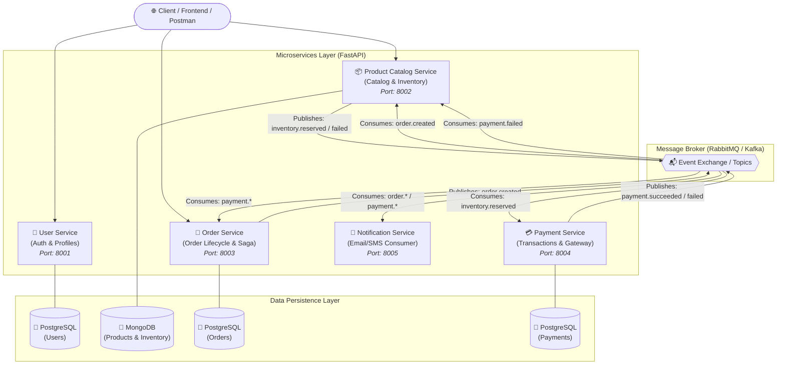
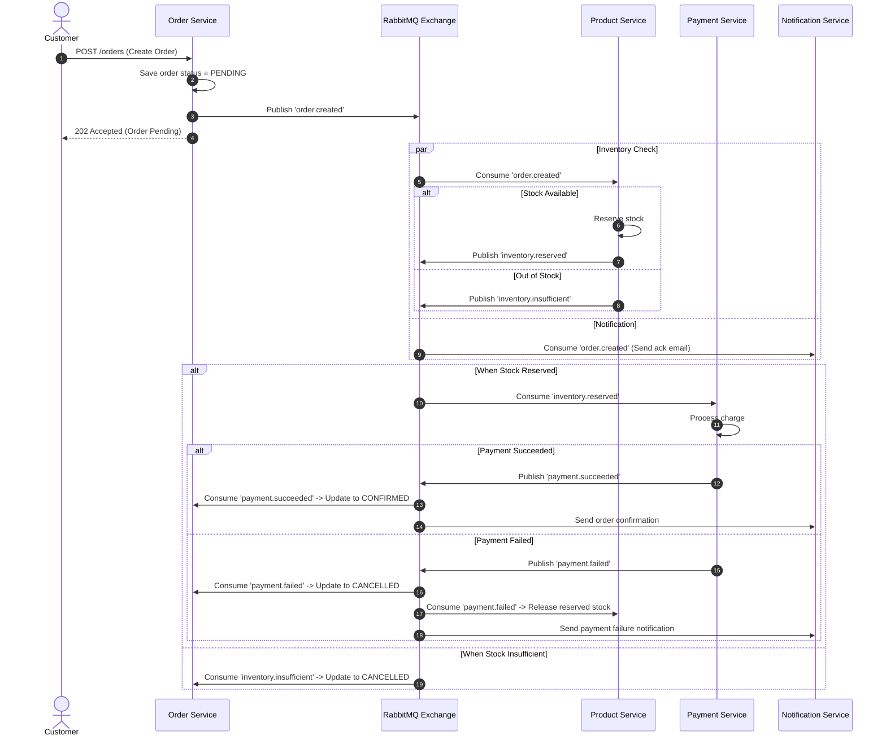

# Event-Driven E-Commerce Microservices Architecture

[](https://github.com/Collinsolayemi/py-commerce-microservices)

An enterprise-grade, asynchronous event-driven e-commerce microservices platform built with **Python**, **FastAPI**, **RabbitMQ** (or Apache Kafka), **PostgreSQL**, **MongoDB**, and **Docker Compose**.

**Repository**: [https://github.com/Collinsolayemi/py-commerce-microservices](https://github.com/Collinsolayemi/py-commerce-microservices)  
📖 **Implementation Guide**: [Step-by-Step Module Guide](IMPLEMENTATION_GUIDE.md)

---

## 🏗️ System Architecture

This project adopts a **Choreography-based Saga Pattern** to handle distributed transactions across decoupled services without a centralized orchestrator.



---

## 📦 Services Breakdown

| Service | Primary Tech | Database | Port | Responsibilities |
|---|---|---|---|---|
| **User Service** | FastAPI, JWT, Passlib | PostgreSQL | `8001` | User registration, authentication, JWT issuing, user profile management. |
| **Product & Inventory Service** | FastAPI, Motor / Beanie | MongoDB | `8002` | Product catalog CRUD, dynamic attributes, stock tracking, and inventory reservation/rollback. |
| **Order Service** | FastAPI, SQLAlchemy | PostgreSQL | `8003` | Creates orders in `PENDING` state, emits `order.created`, updates status to `CONFIRMED` or `CANCELLED`. |
| **Payment Service** | FastAPI, SQLAlchemy | PostgreSQL | `8004` | Simulates payment gateway processing, handles idempotency, emits payment results. |
| **Notification Service** | FastStream / aio-pika | None / Redis | `8005` | Consumes events and sends simulated emails/notifications. |

---

## 🔄 The Saga Flow (Distributed Transaction)



---

## 📁 Recommended Project Directory Layout

```text
python-ecommerce/
├── docker-compose.yml              # Multi-container orchestration
├── .env.example                     # Environment template
├── common/                          # Shared package / schemas across services
│   ├── setup.py
│   └── common/
│       ├── events.py                # Base Pydantic event schemas
│       ├── messaging.py             # RabbitMQ publisher/consumer wrappers
│       └── security.py              # JWT token verification helpers
│
├── services/
│   ├── user_service/
│   │   ├── Dockerfile
│   │   ├── requirements.txt
│   │   └── app/
│   │       ├── main.py
│   │       ├── core/config.py
│   │       ├── models/
│   │       ├── routers/
│   │       └── services/
│   │
│   ├── product_service/
│   │   ├── Dockerfile
│   │   ├── requirements.txt
│   │   └── app/
│   │       ├── main.py
│   │       ├── consumer.py          # RabbitMQ background worker
│   │       ├── models/
│   │       └── routers/
│   │
│   ├── order_service/
│   │   ├── Dockerfile
│   │   ├── requirements.txt
│   │   └── app/
│   │       ├── main.py
│   │       ├── consumer.py
│   │       ├── models/
│   │       └── routers/
│   │
│   ├── payment_service/
│   │   ├── Dockerfile
│   │   ├── requirements.txt
│   │   └── app/
│   │       ├── main.py
│   │       ├── consumer.py
│   │       └── models/
│   │
│   └── notification_service/
│       ├── Dockerfile
│       ├── requirements.txt
│       └── app/
│           └── consumer.py          # Pure event consumer worker
│
└── tests/                           # End-to-end integration tests
```

---

## 🛠️ Step-by-Step Implementation Roadmap

### Phase 1: Shared Event Definitions & Broker Setup
1. Define standardized message formats using Pydantic:
   - `OrderCreatedEvent`
   - `InventoryReservedEvent`
   - `InventoryFailedEvent`
   - `PaymentSucceededEvent`
   - `PaymentFailedEvent`
2. Configure RabbitMQ with a Topic Exchange (e.g., `ecommerce_exchange`) and specific routing keys (e.g., `order.created`, `payment.succeeded`).

### Phase 2: User Service (Auth & Users)
1. Setup FastAPI with PostgreSQL (SQLAlchemy async + asyncpg).
2. Implement password hashing (`passlib[bcrypt]` or `argon2`) and JWT issuance (`pyjwt` or `authlib`).
3. Create endpoints: `POST /users/register`, `POST /users/login`, `GET /users/me`.

### Phase 3: Product & Inventory Service
1. Connect FastAPI to MongoDB using `motor` or `beanie` (great for flexible product specs).
2. Product CRUD endpoints: `GET /products`, `POST /products`.
3. Background consumer: Listen to `order.created` -> atomically decrement or reserve stock (`find_one_and_update`).
4. Emit `inventory.reserved` or `inventory.insufficient`.

### Phase 4: Order Service
1. Create Orders database table with columns: `id`, `user_id`, `items`, `total_amount`, `status` (`PENDING`, `CONFIRMED`, `CANCELLED`).
2. Endpoint: `POST /orders` -> saves order as `PENDING`, publishes `order.created` to RabbitMQ.
3. Consumer: Listens to `payment.succeeded` -> transitions to `CONFIRMED`; listens to `payment.failed` or `inventory.insufficient` -> transitions to `CANCELLED`.

### Phase 5: Payment Service
1. Consumer: Listens to `inventory.reserved`.
2. Process mock payment logic (or integrate Stripe/PayPal test sandbox).
3. Implement an **Idempotency Key** table to avoid double charges on redelivered events.
4. Emit `payment.succeeded` or `payment.failed`.

### Phase 6: Dockerize & Orchestrate
1. Write optimized multi-stage `Dockerfile`s for each service.
2. Link everything with `docker-compose.yml` (services, PostgreSQL, MongoDB, RabbitMQ with Management UI).

---

## 🔑 Key Distributed Patterns to Implement

1. **Idempotent Consumers**: Every event payload contains an `event_id` or `order_id`. Consumers must check a processed-events store before processing duplicates.
2. **Dead Letter Queue (DLQ)**: Failed message deliveries route to a DLQ exchange (`ecommerce_dlx`) after retries to prevent blocking the message queues.
3. **Compensating Transactions (Saga)**: If step N fails (e.g. payment failure), compensating events are emitted to undo previous steps (e.g., release reserved inventory).

---

## 🚀 Quickstart Guide (Local Development)

### 1. Prerequisites
- [Docker](https://www.docker.com/) & Docker Compose
- Python 3.11+
- [uv](https://github.com/astral-sh/uv) or `poetry` or `venv`

### 2. Setup & Running
```bash
# Clone the repository
git clone https://github.com/Collinsolayemi/py-commerce-microservices.git
cd py-commerce-microservices

# Spin up all microservices, databases, and message broker
docker compose up --build
```

### 3. Service Dashboard & Access URLs
- **RabbitMQ Management UI**: [http://localhost:15672](http://localhost:15672) (User: `guest` / Pass: `guest`)
- **User Service Docs**: [http://localhost:8001/docs](http://localhost:8001/docs)
- **Product Service Docs**: [http://localhost:8002/docs](http://localhost:8002/docs)
- **Order Service Docs**: [http://localhost:8003/docs](http://localhost:8003/docs)
- **Payment Service Docs**: [http://localhost:8004/docs](http://localhost:8004/docs)


## Authenticated Orders (Module 7)

Log in using `POST http://localhost:8001/users/login` and include the returned access token as `Authorization: Bearer <access_token>` on every request to the Order Service at port 8003.

Create an order without supplying a customer ID:
```bash
curl -X POST http://localhost:8003/orders \
  -H "Authorization: Bearer $ACCESS_TOKEN" \
  -H "Content-Type: application/json" \
  -d '{"items":[{"product_id":"PRODUCT_ID","quantity":2,"unit_price":12.50}]}'
```

`GET /orders` lists only the signed-in customer's orders. `GET /orders/{order_id}` and `POST /orders/{order_id}/cancel` require ownership. Missing or invalid tokens return 401; attempts to supply another customer ID return 403; missing or other customers' order IDs return 404. Legacy `user_id` body/query fields are accepted only when they match the token subject.

Set matching `JWT_SECRET_KEY` and `JWT_ALGORITHM` values for User and Order services; Docker Compose now shares those settings. Rebuild both services with `docker compose up -d --build user-service order-service` after upgrading. Other service endpoints retain their existing access behavior.

Run the HTTP and Saga regression tests:
```bash
python3 -m pip install -r requirements-dev.txt
python3 -m unittest tests.test_order_security tests.test_e2e_saga -v
PYTHONPATH=common python3 common/tests/test_events.py
```
